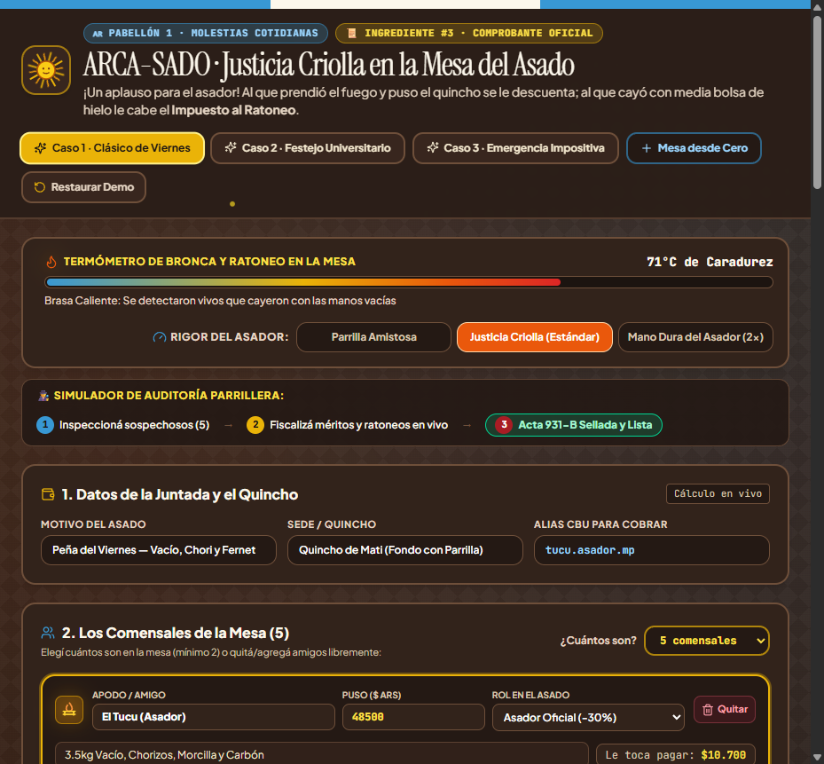
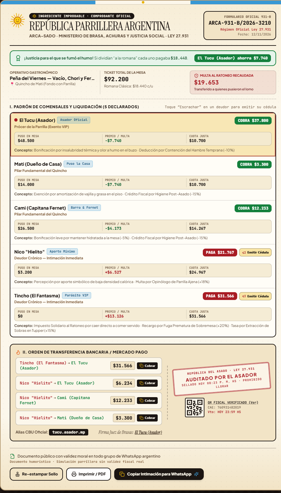
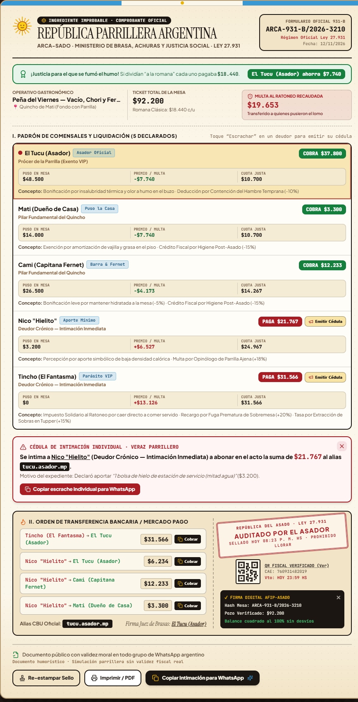

# ARCA-SADO (AFIP del Asado y Justicia Parrillera)

**Pabellón:** Pabellón 1 - Molestias Cotidianas
**Ingrediente improbable:** 3. Comprobante oficial

## El problema
En toda juntada o asado argentino pasa siempre lo mismo: después de tres semanas en WhatsApp para coordinar, uno compra toda la carne y se fuma el humo de la parrilla durante tres horas, otro pone el quincho y limpia la grasa del piso, y nunca falta el amigo que cae a las 23:15 con media bolsa de hielo derretido de estación de servicio pero pretende que se divida todo "a la romana" en partes iguales.

## La solución
**ARCA-SADO (Agencia de Recaudación y Control del Asado)** audita lo que gastó, trajo e hizo cada comensal y reemplaza la injusta cuenta "a la romana" por el **Régimen Impositivo de Solidaridad Parrillera (Ley N° 27.931)**. Bonifica con descuentos fiscales al Asador Titular (-30%), a quien Puso la Sede (-25%) y a quien lavó los platos (-15%), financiando ese alivio con la **Percepción Solidaria por Ratoneo (+22% a +42%)** aplicada a los que cayeron con las manos vacías o hicieron bomba de humo antes de limpiar. Como resultado central, emite en vivo el **Formulario Oficial 931-B (Comprobante Oficial)** con sello de goma, desglose impositivo al centavo, orden de transferencia al Alias CBU y botón para copiar la intimación directamente al grupo de WhatsApp o imprimir el acta en PDF.

## Cómo probarlo
1. Instalar dependencias y levantar el servidor local:
   ```bash
   npm install
   npm run dev
   ```
2. Al abrir la aplicación en el navegador, funciona como un **Simulador de Auditoría Parrillera en 3 pasos**:
   - **Paso 1 (Inspeccionar sospechosos):** Ya viene precargada con un caso real argentino (*"Asado de Viernes con los Pibes"*), 3 botones superiores de **Casos Demo en 1 Clic** (*Clásico de Viernes*, *Festejo Universitario* y *Operativo Caza de Ratones*) y el botón **"+ Mesa desde Cero"** con selector desplegable de **2 a 10 comensales**.
   - **Paso 2 (Fiscalizar en vivo):** Podés modificar cuánta plata puso cada amigo, elegir su rol (*Asador Oficial*, *Puso la Casa*, *Invitado Normal*, *Barra & Fernet*, *Cayó con Hielo* o *Parásito VIP*), tildar méritos o infracciones y ajustar el **Rigor del Asador** (*Parrilla Amistosa*, *Justicia Criolla* o *Mano Dura 2x*). Al seleccionar a un amigo a la izquierda, su fila se ilumina en vivo en el acta de la derecha.
   - **Paso 3 (Sellar y ejecutar el Acta 931-B):** Si cambiás un dato después de sellar, el acta pide **Rectificativa (Volver a Sellar)**. Al presionar **"¡Sellar Acta 931-B!"** se estampa el sello de goma con sonido, hora exacta y confeti.
3. En el **Formulario Oficial 931-B** podés **Emitir Cédula de Escrache individual** a cualquier deudor, tocar **"Cobrar"** al lado de cada transferencia para copiar el reclamo puntual, verificar el **Certificado Digital QR**, **Imprimir / PDF Oficial** o **Copiar la Intimación General para WhatsApp**.

## Herramientas de IA utilizadas
- **ChatGPT (Ideación de Producto y Diseño de Agent Skills):** Conceptualización del flujo interactivo como *"Simulador de Auditoría Parrillera"* (manteniendo al Comprobante Oficial como único ingrediente improbable) y creación de 4 skills modulares a medida para dirigir al agente de código:
  - `arca-sado-visual-direction`: Identidad visual de burocracia parrillera criolla, jerarquía tipográfica y diseño responsive a pantalla dividida.
  - `arca-sado-gamefeel`: Microinteracciones táctiles de auditoría, conexión bidireccional entre comensal y fila del acta, y ciclo de sellado/rectificativa.
  - `arca-sado-receipt`: Maquetación del Formulario Oficial 931-B, conservación exacta de saldos, impresión `@media print` y exportación para WhatsApp.
  - `arca-sado-demo-qa`: Auditoría de cumplimiento de las 5 condiciones obligatorias del hackathon y pruebas de casos de borde.
- **El Gentleman (Pi Coding Agent) + Claude / Gemini + Impeccable Design Skill:** Lectura y cumplimiento de las reglas de arquitectura (`AGENTS.md` y carpeta `rules/`), implementación modular del motor fiscal en TypeScript (`src/logic/asadoTaxEngine.ts`), interfaz interactiva en React (`src/App.tsx`, `src/components/OfficialReceiptCard.tsx`), síntesis de sonido de sello de goma vía Web Audio API y pruebas unitarias automatizadas con Vitest (`npm test`).

## 📸 Capturas de Pantalla (`screenshots/`)
| Vista General del Simulador | Formulario Oficial 931-B | Cédula de Intimación Individual |
| :---: | :---: | :---: |
|  |  |  |

---

# 🇬🇧 English Version — ARCA-SADO (Argentine BBQ Tax & Fairness Agency)

**Pavilion:** Pavilion 1 - Everyday Annoyances (*Molestias Cotidianas*)
**Improbable Ingredient:** 3. Official Receipt (*Comprobante oficial*)

## The Problem
At every Argentine *asado* (barbecue) gathering with friends, the exact same injustice happens: after three weeks of debating in a WhatsApp group to pick a date, one person buys all the meat and stands in front of the hot grill inhaling smoke for three hours, another hosts at their house and scrubs grease off the floor, and there is always that one friend who shows up at 11:15 PM with half a bag of melted gas-station ice—yet expects the bill to be split evenly (*"a la romana"*).

## The Solution
**ARCA-SADO (Agencia de Recaudación y Control del Asado)** works as an interactive **Barbecue Audit Simulator** that audits what each attendee spent, brought, and contributed, replacing unfair equal-splitting with the **Solidarity Grill Tax Regime (Law No. 27,931)**. It rewards the Grill Master (-30%), the House Host (-25%), and whoever washed the dishes (-15%), funding those tax reliefs through the **Solidarity Freeloader Surcharge (*Impuesto al Ratoneo*, +22% to +42%)** levied on attendees who arrived empty-handed or vanished before cleaning up. As its centerpiece, it dynamically issues **Official Form 931-B (*Formulario Oficial 931-B*)** complete with an interactive rubber stamp (with sound and timestamp), exact peso-level accounting breakdown, digital QR verification certificate, bank/alias transfer orders, individual debtor notices (*Cédula de Escrache*), print-ready PDF layout, and 1-click WhatsApp export.

## How to Test It
1. Install dependencies and start the local development server:
   ```bash
   npm install
   npm run dev
   ```
   *(Optional: run automated unit tests and production build with `npm test && npm run build`).*
2. Open `http://localhost:5173/` in your browser. The app operates as a **3-Step Barbecue Audit Simulator**:
   - **Step 1 (Inspect Suspects):** Pre-loaded with a realistic Argentine scenario (*"Asado de Viernes con los Pibes"*), 3 top **1-Click Demo Presets** (*Clásico de Viernes*, *Festejo Universitario*, and *Operativo Caza de Ratones*), plus a **"+ Mesa desde Cero" (Blank Table)** button and a dropdown selector for **2 to 10 attendees**.
   - **Step 2 (Live Fiscal Audit):** Edit how much money each friend spent, assign their role (*Asador Oficial*, *Puso la Casa*, *Invitado Normal*, *Barra & Fernet*, *Cayó con Hielo*, or *Parásito VIP*), toggle merits or infractions, and switch the **Grill Master Rigor** (*Parrilla Amistosa*, *Justicia Criolla*, or *Mano Dura 2x*). Selecting any friend on the left highlights their corresponding ledger row inside Form 931-B on the right.
   - **Step 3 (Seal & Execute Form 931-B):** Modifying any input after sealing automatically marks the receipt as **Amendment Required (*Rectificativa · Volver a Sellar*)**. Clicking **"¡Sellar Acta 931-B!"** stamps the official seal with realistic rubber-stamp audio, live timestamp, and confetti.
3. On **Official Form 931-B**, you can issue an individual **Debtor Notice (*Emitir Cédula*)**, click **"Cobrar"** next to any transfer row to copy that specific payment demand, inspect the **Digital QR Certificate**, click **"Imprimir / PDF"**, or **"Copiar Intimación para WhatsApp"**.

## AI Tools Used
- **ChatGPT (Product Ideation & Custom Agent Skills Design):** Framed the interactive experience as a *"Barbecue Audit Simulator"* centered strictly around the single Improbable Ingredient (*Official Receipt*) and authored 4 custom modular skills to guide implementation:
  - `arca-sado-visual-direction`: Argentine fiscal-parody aesthetic, editorial typography, and responsive split-screen layout.
  - `arca-sado-gamefeel`: Tactile audit micro-interactions, bidirectional suspect-to-receipt row highlighting, and seal/amendment lifecycle.
  - `arca-sado-receipt`: Official Form 931-B layout, strict peso balance conservation, `@media print` stylesheet, and WhatsApp clipboard formatting.
  - `arca-sado-demo-qa`: Verification checklist for all 5 mandatory hackathon prototype conditions and edge-case testing.
- **El Gentleman (Pi Coding Agent) + Claude / Gemini + Impeccable Design Skill:** Enforced repository rules (`AGENTS.md` and `rules/`), built the pure TypeScript tax calculation engine (`src/logic/asadoTaxEngine.ts`), implemented the interactive React workstation (`src/App.tsx`, `src/components/OfficialReceiptCard.tsx`), synthesized the rubber-stamp audio via Web Audio API, and verified calculations with Vitest (`npm test`).

